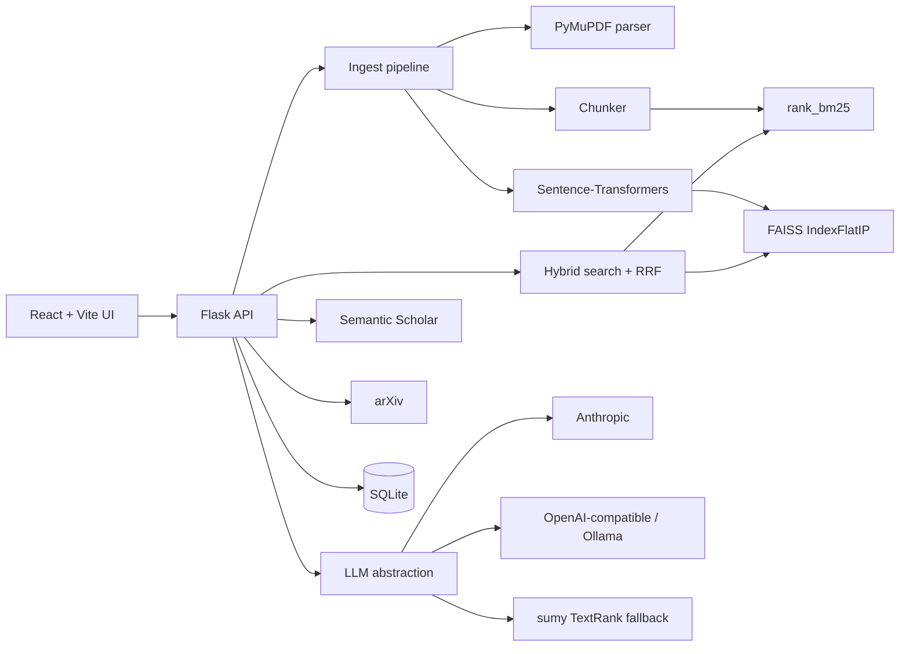

# Research Paper Analyzer & Semantic Search Engine

Web app for ingesting research PDFs (or arXiv papers), splitting them into sections, and searching the library by **meaning** (dense embeddings + BM25 hybrid retrieval). Summaries, RAG Q&A with citations, similar papers, topics, and pairwise comparison are included.

## Architecture



## Setup (venv + npm)

### Backend (Python 3.11+)

```bash
cd research-paper-engine/backend
python -m venv .venv
# Windows: .venv\Scripts\activate
# Unix: source .venv/bin/activate
pip install -r requirements.txt
cd ..
copy .env.example .env   # Windows
# cp .env.example .env   # Unix
```

First run of `sentence-transformers/all-MiniLM-L6-v2` downloads the model (~90 MB). Tests set `USE_HASH_EMBEDDINGS=1` so they do not require the model.

```bash
cd backend
python run.py
```

API: http://127.0.0.1:5000/api/health

### Frontend

```bash
cd research-paper-engine/frontend
npm install
npm run dev
```

UI: http://127.0.0.1:5173 (proxies `/api` to Flask).

## Environment variables

See `.env.example`:

| Variable | Purpose |
|---|---|
| `DATA_DIR` | SQLite, FAISS, BM25, uploaded PDFs |
| `EMBEDDING_MODEL` | Default `sentence-transformers/all-MiniLM-L6-v2` |
| `LLM_PROVIDER` | `gemini` (default), `anthropic`, or `openai` |
| `GEMINI_API_KEY` / `GEMINI_MODEL` | Google Gemini (summarize, Q&A, compare) |
| `ANTHROPIC_API_KEY` / `ANTHROPIC_MODEL` | Claude |
| `OPENAI_BASE_URL` / `OPENAI_API_KEY` / `OPENAI_MODEL` | Ollama or other compatible servers |
| `CITATION_WEIGHT` / `RELEVANCE_WEIGHT` | Hybrid final score mix |
| `MAX_UPLOAD_MB` | Upload cap (default 25) |

If no LLM key is set, summarization uses TextRank and Q&A returns retrieved chunks. The app does not crash.

Rebuild indexes from SQLite:

```bash
cd backend
python -m app.scripts.rebuild_index
```

## Docs

- [API reference](docs/API.md)
- [Bulk multi-site ingest](docs/BULK_INGEST.md)
- [Vercel deployment](docs/DEPLOYMENT_VERCEL.md)

## Seed demo data

Downloads ~30 NLP/IR papers from arXiv and ingests them (needs network; several minutes):

```bash
cd backend
python scripts/seed_demo.py
```

## Tests

```bash
cd backend
set USE_HASH_EMBEDDINGS=1
pytest -q
```

Covers section splitting, chunking, FAISS add/search/delete, RRF, citation boost, upload validation, and API smoke tests (LLM and Semantic Scholar are not required).

## Retrieval evaluation

After seeding:

```bash
cd backend
python scripts/evaluate.py
```

Prints Precision@5, Recall@10, MRR, nDCG@10 for keyword vs semantic vs hybrid and writes `evaluation_results.csv`.

## Docker

```bash
cd research-paper-engine
docker compose up --build
```

`DATA_DIR` is the `paper-data` volume.

## Screenshot checklist

- [ ] Search: hybrid results with highlighted passage, score badge, cite count
- [ ] Library table with status + drag-and-drop upload
- [ ] Upload/Import: arXiv search, import progress bar
- [ ] Paper detail: sections accordion, summary, keyword chips, similar papers, chat citations
- [ ] Ask: library-wide Q&A
- [ ] Compare: two-column table
- [ ] Topics: recharts scatter colored by cluster
- [ ] Dark mode toggle
- [ ] Empty library / empty query states
- [ ] Notice when LLM key is missing
