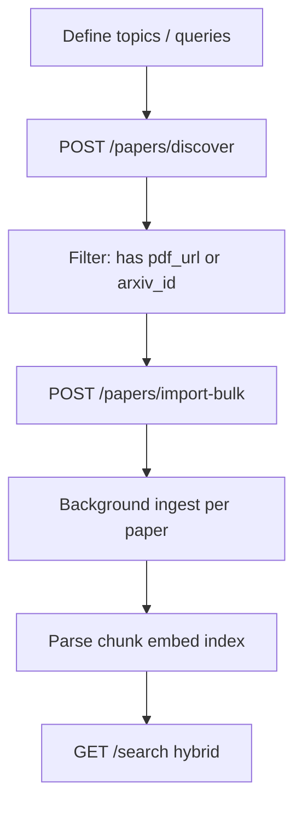

# Building a large multi-site research library

This app does **not** crawl the whole web. It **imports PDFs you discover**, then indexes them locally (SQLite + FAISS + BM25). For tens of thousands of papers, run the backend on a VM with persistent disk and use batch jobs.

## Supported discovery sources

| Source | API | What you get |
|--------|-----|----------------|
| **arXiv** | Official arXiv API | PDF always available; best for CS/ML/physics preprints |
| **OpenAlex** | `api.openalex.org` | 250M+ works; metadata + **open-access PDF URLs** when available |
| **Semantic Scholar** | Graph API | Metadata + `openAccessPdf` when available; rate limits apply |

Upload and **direct PDF URL** import work for publishers that expose OA PDFs (PMC, some IEEE/ACM OA, institutional repos).

## Recommended pipeline (scale)



### Step 1 — Plan queries

Use many narrow queries instead of one huge query (e.g. `"neural IR"`, `"dense passage retrieval"`, `"scientific document embeddings"`). OpenAlex: add filters later via API (`filter=open_access.is_oa:true` is already default in discover).

### Step 2 — Discover

```http
POST /api/papers/discover
{
  "query": "information retrieval neural",
  "sources": ["arxiv", "openalex", "semantic_scholar"],
  "max_per_source": 50
}
```

Use `merged` for deduplicated candidates; keep only rows with `arxiv_id` or `pdf_url`.

### Step 3 — Bulk import (batches of 50–200)

```http
POST /api/papers/import-bulk
{
  "items": [ { "arxiv_id": "..." }, { "pdf_url": "...", "title": "..." } ],
  "delay_sec": 2
}
```

Dedup: same **SHA-256** file hash, **arXiv ID**, or **DOI** returns existing paper.

### Step 4 — Monitor

Poll `GET /api/papers?status=processing` and per-paper `/papers/{id}/status`.

### Step 5 — Rebuild indexes (after failures)

```bash
cd backend
python -m app.scripts.rebuild_index
```

## CLI helpers

```bash
# ~30 arXiv NLP/IR papers (synchronous ingest)
python scripts/seed_demo.py

# Custom harvest (edit queries inside script)
python scripts/bulk_harvest.py --query "retrieval augmented generation" --max 100
```

## Production notes for “huge” corpora

- **Do not** run bulk import from Vercel serverless (no persistent disk, short timeouts, no FAISS model load).
- Use **Docker** on Railway / Render / Fly.io / a VPS with volume mounted at `DATA_DIR`.
- For **100k+** papers, replace in-thread workers with **Celery + Redis** and a job queue (same ingest functions).
- Respect **rate limits**: arXiv (~1 req/s), Semantic Scholar (backoff built in), OpenAlex (polite pool + `mailto` in requests).
- Only import **legal OA PDFs** or papers you have rights to store.

## Search after ingest

```http
GET /api/search?q=your+question&mode=hybrid&k=20
```

Hybrid = FAISS semantic + BM25 RRF + optional citation boost from Semantic Scholar counts at ingest time.
